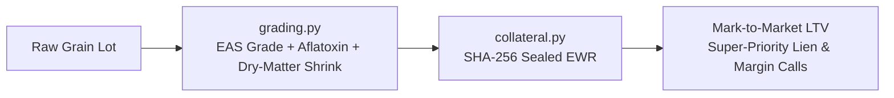

# wrs-engine

[](https://github.com/codesphere-u/wrs-engine/actions/workflows/ci.yml)
[](LICENSE)
[](pyproject.toml)
[](pyproject.toml)

**Zero-dependency Agricultural Warehouse Receipt System (WRS) engine: exact Decimal dry-matter moisture shrinkage, EAGC/EAS grain grading & aflatoxin gates, SHA-256 sealed EWRs, and mark-to-market LTV margin calls.**

- **Mission Domain:** Financial Inclusion & Agricultural Commodity Collateral
- **Stack:** Pure Python 3.11+ (zero runtime third-party dependencies, `mypy --strict`, `ruff`, `pytest`)
- **Maintainer:** Codesphere Innovations (U) Limited (`codesphere-u`)

---

## Problem Solved

Smallholder farmers forced to sell at harvest lose 40–60% of seasonal grain value, yet rural warehouses and lenders lack transparent, exact-Decimal open-source software for moisture shrinkage, aflatoxin gating, and collateral margin-call math.

## Key Features

- Exact dry-matter-conserving `Decimal` moisture shrinkage (`moisture_shrinkage_weight`) and East African Standard (`EAS 2`, `EAS 46`, `EAS 105`, `EAS 757`, `EAS 895`) grading + `<=10 ppb` aflatoxin gates.
- Tamper-evident SHA-256 Electronic Warehouse Receipts (`issue_warehouse_receipt`, `verify_warehouse_receipt`).
- Mark-to-market collateral risk engine (`evaluate_mark_to_market`) deducting super-priority warehouse storage liens first and computing exact cash or grain-kg top-ups on margin calls.

## Architecture Overview



See [docs/architecture.md](docs/architecture.md) for module-level design details.

## Installation

```bash
git clone https://github.com/codesphere-u/wrs-engine.git
cd wrs-engine
uv sync --extra dev
```

Or install in editable mode with standard `pip`:

```bash
pip install -e ".[dev]"
```

## Quick Start (CLI)

```bash
wrs-engine --commodity maize --gross-kg 10000 --moisture 17.5 --loan 1800 --spot-price 0.35
```

## Quick Start (Python API)

```python
from decimal import Decimal
from wrs_engine import DeliveryLot, evaluate_delivery_intake, issue_warehouse_receipt

intake = evaluate_delivery_intake(DeliveryLot('maize', Decimal('10000'), Decimal('17.5'), Decimal('0.4'), Decimal('1.5')))
ewr = issue_warehouse_receipt(intake, warehouse_id='WH-1', depositor_id='COOP-1')
assert ewr.receipt_id.startswith('EWR-')
```

## Testing & Quality Gates

```bash
uv run ruff check src tests
uv run mypy src
uv run pytest -v
```

## Security, Contributing & Roadmap

- **Security:** See [SECURITY.md](SECURITY.md) for responsible disclosure procedures.
- **Contributing:** See [CONTRIBUTING.md](CONTRIBUTING.md) and [CODE_OF_CONDUCT.md](CODE_OF_CONDUCT.md).
- **Changelog & Roadmap:** See [CHANGELOG.md](CHANGELOG.md) and [ROADMAP.md](ROADMAP.md).

## License

MIT License — see [LICENSE](LICENSE).

## Support & Contact

Open an issue on [GitHub Issues](https://github.com/codesphere-u/wrs-engine/issues) or contact `codesphereinnovationz@gmail.com`.
